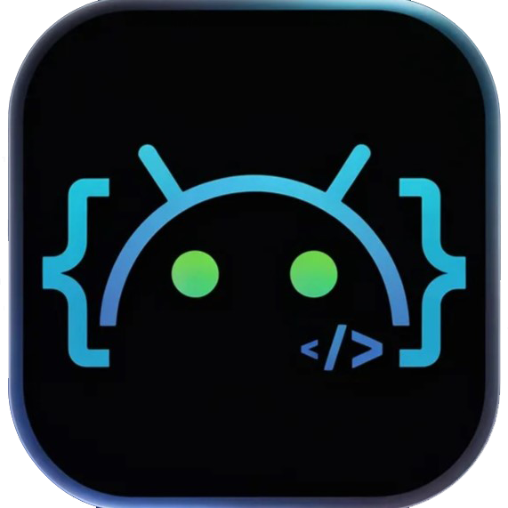
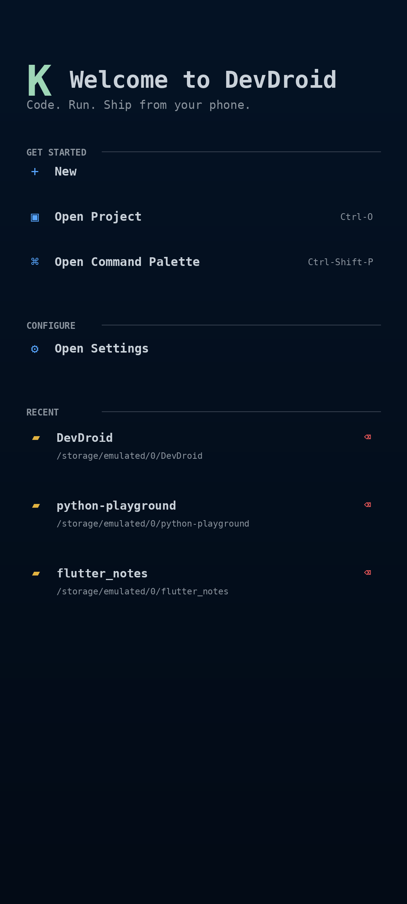
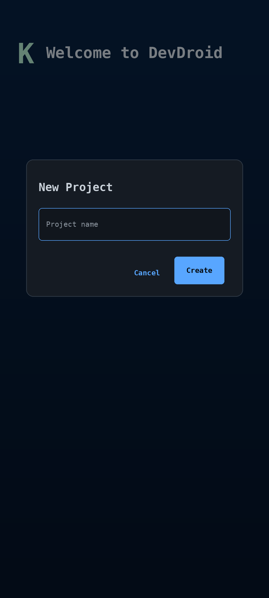
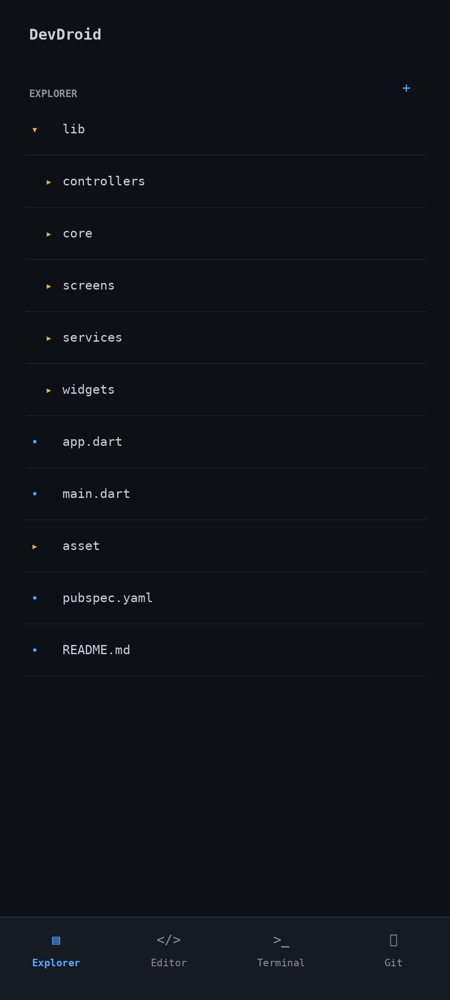
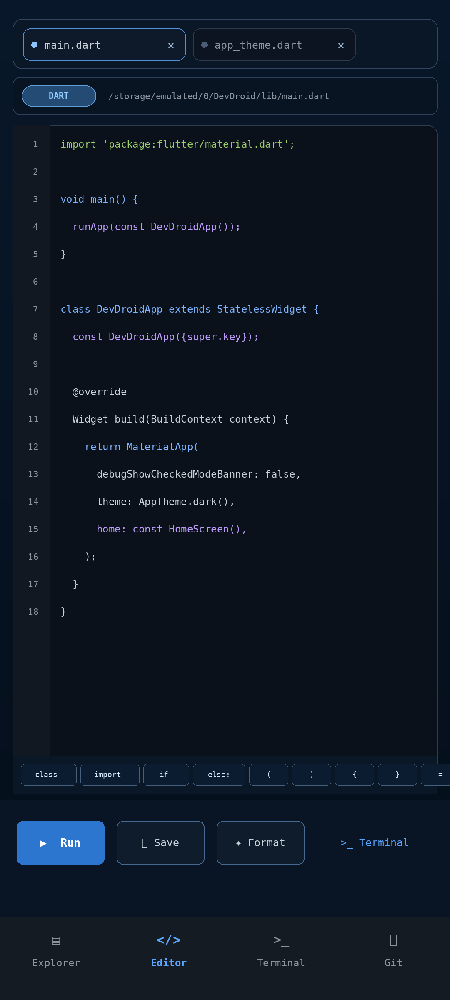
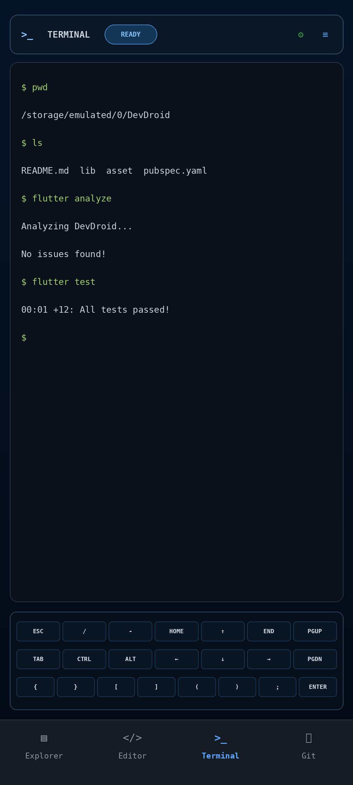
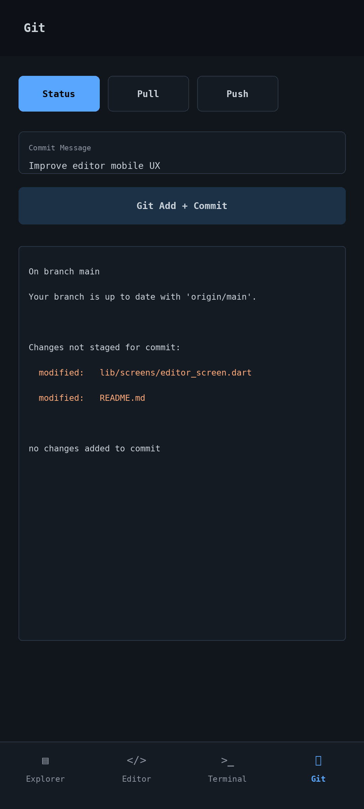
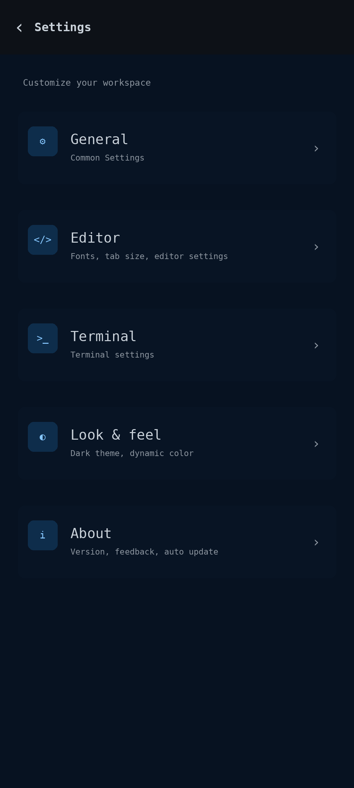
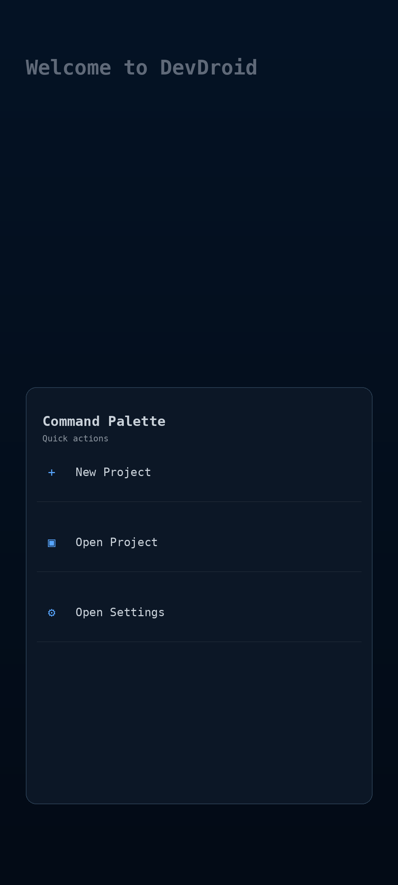

<div align="center">
  
  <h1>DevDroid</h1>
  <p><strong>Your coding workspace, on Android.</strong></p>
  <p>Browse projects, edit code, run commands, and work with Git from your phone.</p>
  <p>
    
    
    <a href="LICENSE"></a>
    <a href="https://github.com/Azrul16/DevDroid-android-code-editor/actions/workflows/ci.yml"></a>
  </p>
  <p><a href="#app-ui">App UI</a> · <a href="#features">Features</a> · <a href="#getting-started">Getting started</a> · <a href="#contributing">Contributing</a></p>
</div>

DevDroid is an Android-first development workspace built with Flutter. It brings a file explorer, tabbed code editor, terminal, and Git controls into one project-focused app.

The project is under active development. Command execution and Git operations use Termux; the interactive terminal connects to Termux over SSH.

## App UI

These UI mockups from the [mockups folder](mockups/) showcase the app's screens and coding workflow. They are design previews; the running app may differ as development continues. Select an image to view it at full size.

<table>
  <tr><th>Home</th><th>New project</th></tr>
  <tr>
    <td align="center"><a href="mockups/01_home.png"></a></td>
    <td align="center"><a href="mockups/02_new_project.png"></a></td>
  </tr>
  <tr><th>Project explorer</th><th>Code editor</th></tr>
  <tr>
    <td align="center"><a href="mockups/03_project_explorer.png"></a></td>
    <td align="center"><a href="mockups/04_editor.png"></a></td>
  </tr>
  <tr><th>Terminal</th><th>Git</th></tr>
  <tr>
    <td align="center"><a href="mockups/05_terminal.png"></a></td>
    <td align="center"><a href="mockups/06_git.png"></a></td>
  </tr>
  <tr><th>Settings</th><th>Command palette</th></tr>
  <tr>
    <td align="center"><a href="mockups/07_settings.png"></a></td>
    <td align="center"><a href="mockups/08_command_palette.png"></a></td>
  </tr>
</table>

## Features

- **Project workspace:** create local projects, reopen recent projects, and browse files in the explorer.
- **Tabbed editor:** edit multiple files with syntax highlighting and language detection.
- **Quick actions:** access run, save, format, and terminal controls from the editor.
- **Terminal integration:** execute commands through Termux and use an SSH-backed interactive terminal.
- **Git controls:** request status, pull, push, and stage all changes with a commit message through Termux.
- **Preferences:** configure editor, appearance, general, and terminal settings.

Running and formatting code require the corresponding tools to be installed and available in Termux.

## Getting started

### Prerequisites

- Flutter SDK with Dart **3.11.4 or a compatible 3.x version**, matching `pubspec.yaml`.
- Android development tools and a device or emulator.
- Termux on the Android device for command execution and Git workflows.

### Run from source

```bash
git clone https://github.com/Azrul16/DevDroid-android-code-editor.git
cd DevDroid-android-code-editor
flutter pub get
flutter run
```

If multiple devices are connected, select your Android device when prompted or use `flutter run -d <device-id>`.

To build a release APK:

```bash
flutter build apk --release
```

The APK is written to `build/app/outputs/flutter-apk/app-release.apk`.

### Connect Termux

1. Open Termux at least once to initialize its environment.
2. Run `termux-setup-storage` and grant storage access so Termux can access shared projects.
3. Set `allow-external-apps=true` in `~/.termux/termux.properties` and reload the Termux settings.
4. Grant DevDroid the Termux `RUN_COMMAND` permission when requested, along with the storage access the app needs.
5. Install Git and the runtimes or formatters required by your projects in Termux.

For the interactive SSH terminal, install `openssh` in Termux, set a password with `passwd`, and start the server with `sshd`. Use your Termux username (shown by `whoami`) and password in DevDroid. The app connects to `127.0.0.1:8022`.

Local projects are stored under `/storage/emulated/0/DevDroidProjects`.

## Built with

| Component | Technology |
| --- | --- |
| App UI | Flutter and Dart |
| State management | Provider |
| Code editor | `re_editor` and `re_highlight` |
| Terminal rendering | `xterm` |
| SSH connection | `dartssh2` |
| Settings persistence | `shared_preferences` |
| Android command execution | Termux through a native platform channel |

## Project structure

```text
lib/
  controllers/   # Project, editor, terminal, and Git state
  core/          # Themes, constants, and utilities
  models/        # Project, file, command, and session models
  screens/       # Workspace screens and settings
  services/      # Files, Git, Termux, SSH, and preferences
  widgets/       # Shared editor, explorer, and terminal components
android/         # Android host and native Termux integration
mockups/         # UI previews displayed in this README
test/            # Flutter tests
```

Android is the primary target. The repository also includes Flutter platform scaffolding for other targets; Termux integration requires Android.

## Contributing

Issues and pull requests are welcome.

1. Fork the repository and create a branch for your change.
2. Follow the existing structure and keep the change focused.
3. Run the checks below before opening a pull request.
4. Describe the behavior change and testing performed. Include screenshots for UI changes and update documentation when setup or behavior changes.

```bash
flutter analyze
flutter test
```

GitHub Actions runs analysis and tests for pull requests and pushes to `main` and `master`.

## License

DevDroid is available under the [MIT License](LICENSE).
